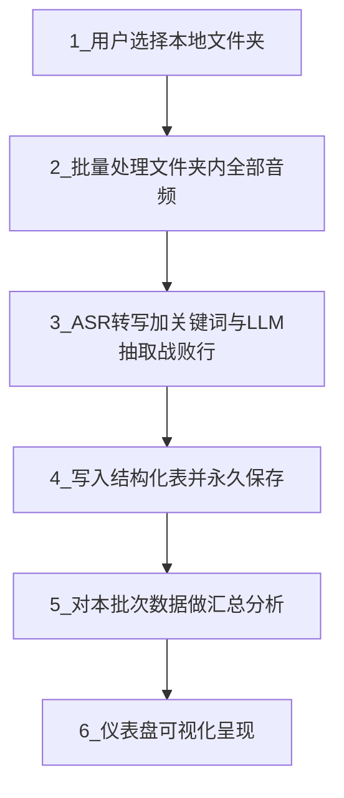

# Lost Leads Bot — MVP 开发计划（已定稿）

本文档整合业务约定、**已拍板配置**与**完整使用流程**（含持久化与仪表盘）。**仪表盘按单次上传批次汇总**；**永久保存为本机 SQLite，备份以手动拷贝库文件 / 导出 CSV 为主**。可按本文进入编码与联调。

---

## 1. 目标与原则

- 销售**继续在群内用语音发战报**，不增加表单负担。
- 结构化表格由系统从语音（经转写）**自动抽取**；战败归因由 **LLM 语义提炼**，不采用 DMS 固定分类。
- 企业微信合规取数并行推进；本 MVP **不依赖**企微 API。
- Demo 使用**脱敏样例音频**；ASR/LLM 走**云厂商试用**时，不以真实客户 PII 出网，满足当前 Demo 场景约定。

---

## 2. 已拍板配置（冻结）

| 项               | 已定方案                                                                                                            |
| --------------- | --------------------------------------------------------------------------------------------------------------- |
| **日期字段 `date`** | **默认取文件日期**：以音频文件的修改时间（或文件系统可靠时间戳）换算为中文日期 `YYYY年M月D日`；同一文件多条战败记录共享该文件日期。若个别格式无可靠时间，回退为「上传处理日」并在日志中标记。           |
| **上传形态**        | **本机 Web + 选择文件夹**：本地运行的轻量 Web 服务 + 前端 `webkitdirectory` / 拖入文件夹，一次提交文件夹内全部音频；**不采用** Electron/Tauri 作为 MVP 必选。 |
| **ASR / 大模型**   | **优先云厂商试用账号**完成联调与演示；Demo 数据为脱敏音频，按当前约定**不单独触发额外合规流程**（正式生产环境仍以公司 IT / 法务政策为准）。                                 |
| **仪表盘汇总范围**     | **仅针对单次上传批次**：每次「开始处理」生成一个 `batch_id`；汇总分析与仪表盘默认展示**该批次**内的全部战败记录；不合并同一自然日下的多批上传。                               |
| **永久保存**        | **本机 SQLite** 单文件数据库；**手动备份**为复制 `.db` 文件及按需 **CSV 导出**；不设自动云备份（本阶段）。                                           |

---

## 3. 业务约定摘要（与此前一致）

| 项           | 约定                                                          |
| ----------- | ----------------------------------------------------------- |
| 战败关键词（规则预筛） | `战败`、`流失`、`弃单`、`不考虑`、`无法挽留`、`跑单了`、`客户掉了`                    |
| 演示数据        | **15 段**音频置于同一本地文件夹；其中 **8 段**含战败信息，**7 段**用于非战败/混合场景以观察误检  |
| 顾问区分        | **文件名带顾问姓名**（如 `陈放_01.mp3`）                                 |
| 表结构         | 以 [table_sample.md](table_sample.md) 为**唯一**表头与字段规范（见第 4 节） |

---

## 4. 与 [table_sample.md](table_sample.md) 的对齐

| 字段    | 英文标识               | 生成方式                                                            |
| ----- | ------------------ | --------------------------------------------------------------- |
| 战败ID  | `loss_id`          | 流水线生成：`L` + 4 位递增；在 SQLite 内**全局唯一**，并关联 `batch_id`（多批次追加不重复编号） |
| 日期    | `date`             | **文件日期**（见第 2 节）                                                |
| 顾问名称  | `consultant`       | 从文件名解析                                                          |
| 车型    | `vehicle_model`    | LLM 抽取；未知时用 `待确认`                                               |
| 客户关键词 | `customer_tags`    | LLM 生成，严禁 PII，遵守 `table_sample`                                 |
| 战败描述  | `loss_description` | LLM **100–300 字**客观过程描述，核心语义洞察集中于此                              |

---

## 5. 使用体验：端到端流程

目标：**同一套本机 Web**，从选文件夹到看到表格与仪表盘，路径连贯、可对内演示。

1. **上传**：用户在网页上选择（或拖入）**一个文件夹**；系统枚举其中支持的音频文件（**预期 15 段**，也允许略多/略少，以实际文件为准），展示列表与开始处理按钮。
2. **批量处理**：对文件夹内**每个**音频依次（或可配置有限并发）执行：ASR → 关键词预筛 → LLM 结构化抽取；单文件失败**不中断**整批，记录错误便于重试。
3. **战败识别**：从转写中识别战败相关叙述，按 `table_sample` 生成**零条或多条**战败记录（演示目标：约 **8 条**战败行）。
4. **永久保存**：每条战败记录写入**本机 SQLite**；可导出 **CSV** 归档。**备份**：由用户**手动**复制数据库文件（及可选 CSV）。多次上传产生多个批次，数据**按批次追加**，历史批次可在 UI 中**下拉或列表选择**查看（实现时至少支持「刚处理完的批次」与「上一批次」便于演示）。
  - **批次**：每次点击「开始处理」生成唯一 `batch_id`（可加 `created_at` 时间戳）；**仪表盘与第 5 步汇总仅针对当前完成的这一批**，不跨批次合并。
5. **战败数据分析**（本批次）：在结构化表落库后，对**该 `batch_id` 下**全部战败记录做一次 **LLM 汇总**：
  - 语义聚类/归纳主要**战败原因主题**（非 DMS 枚举，自由表述 + 可重复出现的短标签）；  
  - 指出可能的**瓶颈**（如价格敏感集中、现车不足、竞品对比失利等）；  
  - 输出可执行的**销售策略调整建议**（条目化，需与表中事实相呼应，减少空泛建议）。
6. **仪表盘（网页）**：独立页面或同站二级页，**可视化**呈现**本批次**第 5 步结果，例如：
  - 摘要卡片：本批战败条数、涉及顾问数、涉及车型数；  
  - 图表：原因主题分布（条形图/饼图）、顾问维度条数对比（若多条记录）；  
  - 文本区：瓶颈解读与策略建议（结构化小节，便于投影朗读）。

技术选型建议（实现阶段）：后端 FastAPI + 模板或极简 Vue/React；图表用 **Chart.js** 或 **ECharts** 等轻量库即可，不引入重型 BI。

---

## 6. 处理流水线（技术视角）

- **云 ASR / 云 LLM**：通过环境变量配置密钥与 endpoint；抽象接口便于日后换厂商。  
- **导出**：除库内保存外，保留 **CSV 导出**按钮，表头对齐 `table_sample`。

---

## 7. 备选路径（非当前首选）

若云试用不可用，仍保留 **全本地 ASR+LLM** 或 **预转写文本跳过 ASR** 作为降级方案（见旧版讨论）；当前主线按第 2 节执行。

---

## 8. 演示数据准备清单

- 单文件夹内 **15** 个音频，文件名含顾问名。  
- **8** 条含清晰战败信息；**7** 条非战败或混合。  
- 内容已脱敏，无真实客户 PII。

---

## 9. 暂不纳入本阶段

- 企业微信自动拉取与定时任务  
- 多用户登录与权限体系  
- 与 DMS 回写  
- 多门店 / 多群 / 云端集中部署

---

## 10. 实现阶段建议

1. 项目骨架：本机 Web、静态上传页、`webkitdirectory`、临时目录与清理策略。
2. 配置：`ASR_*`、`LLM_*` 环境变量、`.env.example`。
3. 流水线：批量 ASR → 抽取 → 校验 `table_sample` → 写入 SQLite。
4. 批次模型：`batches` 表或等价结构，关联每条战败记录，**汇总与仪表盘仅按 `batch_id` 过滤**。
5. 汇总分析：聚合**该批次**战败文本 → LLM 输出 JSON（主题、瓶颈、策略列表）→ 存库（如 `batch_insights` 表）。
6. 仪表盘页：默认展示**刚处理完成的 `batch_id`**；可选历史批次切换。
7. CSV 导出与 15 条样例回归（期望约 8 条战败）。
8. 5–10 分钟演示脚本：选文件夹 → 进度 → 表格 → 仪表盘。

---

## 11. 业务确认记录

| 日期   | 确认内容                                            |
| ---- | ----------------------------------------------- |
| （定稿） | 仪表盘与 LLM 汇总**仅针对单次上传批次**，不合并自然日多批。              |
| （定稿） | 永久保存为**本机 SQLite**；**手动备份**（复制库文件 + 可选 CSV 导出）。 |

